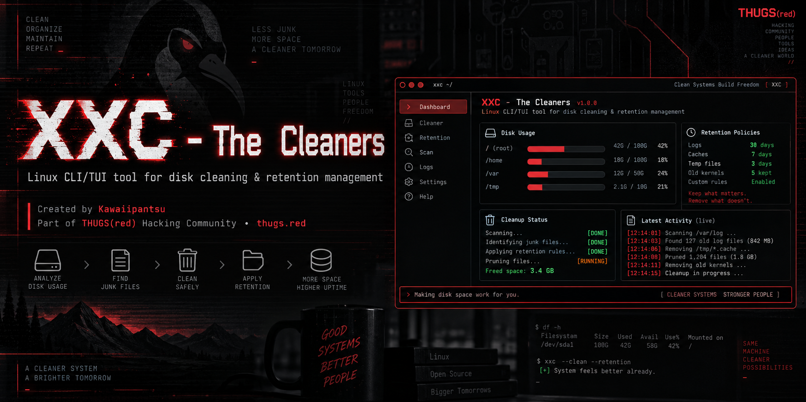

<div align="center">



# XXC The Cleaners

**When things get messy, you call in The Cleaners.**

A fast, safe retention & cleanup tool for Linux servers and workstations.<br>
Caches, stale logs, core dumps and build junk — found, measured and taken out, only when you say so.


[](LICENSE)

[**Download**](https://github.com/kawaiipantsu/xxc-cleaners/releases/latest) · [**What it cleans**](#-what-it-cleans) · [**Install**](#-build--install) · [**Usage**](#-usage) · [**TUI**](#️-the-interactive-tui) · [**Controls**](#️-controls) · [**THUGS(red)**](https://thugs.red)

<samp>by Kawaiipantsu · THUGS(red) · safe by default, autonomous when you need it</samp>

</div>

## 🧹 Find · Measure · Protect · Reclaim

You have a disk at 97% and a question: *what is eating all the space, and what is safe to delete?* `xxc-cleaners` sweeps the usual suspects across the whole machine, shows you exactly what it found and how much it would free — then cleans only what you approve, or runs fully unattended from crontab.

**Dry-run is the default.** A bare `xxc-cleaners` run never deletes anything; you add `--yes` to clean for real. A built-in whitelist means databases, `/etc`, boot files and Docker volumes are **never** touched, no matter how you invoke it.

| | What you get |
| :-- | :-- |
| 🔎 **Discovery** | One pass over user & root caches, `/tmp`, APT cache, rotated/compressed logs, Apache logs, pip/npm/yarn/pnpm & Go build caches, browser caches, old AI-assistant caches, core dumps, the journal and Docker build cache. |
| 📊 **Storage analysis** | A disk/partition/inode overview with usage bars, plus a "largest files" analyzer to find what's actually taking up room. |
| 🖥️ **Visual TUI** | `--interactive` opens a full-screen interface with ANSI/CP box borders, Nerd Font icons, **live search & filtering** of findings, selection, and a disk-usage map. |
| 🛡️ **Protection** | A hard whitelist (`/etc`, MySQL/MariaDB/PostgreSQL/Mongo/Redis data, Docker volumes, SSH keys, boot…) that is re-checked at the moment of deletion. |
| ⏱️ **Retention** | Global and per-area "older than N days" windows, so you keep the recent and reclaim the stale. |
| 🤖 **Autonomous** | Every option is a CLI flag or config value. `--silent --yes` runs clean from cron; stagger multiple entries across different areas and retentions. |
| 🧪 **Safe** | `--dry-run` previews everything. Deletions pass the whitelist twice. Commands (journal/docker/apt) are shown before they run. |

## 🧰 What it cleans

Run `xxc-cleaners --list` to see keys, categories, state and retention on your host.

| Key | Area | What it reclaims |
| :-- | :-- | :-- |
| `user-cache` | caches | `~/.cache` for every real user |
| `root-cache` | caches | `/root/.cache` |
| `browser-cache` | caches | Firefox/Chrome/Chromium/Edge/Brave caches |
| `ai-caches` | caches | Claude/Codex/Gemini/Ollama **cache** dirs & old conversations (never credentials) |
| `tmp` | system | `/tmp` and `/var/tmp` |
| `apt-cache` | system | `/var/cache/apt/archives/*.deb` (re-downloadable) |
| `core-dumps` | system | systemd coredumps, `/var/crash`, stray `core.*` |
| `var-log` | logs | rotated & compressed logs (`*.1`, `*.gz`, `*.1.gz`, `*.old`) |
| `apache-logs` | logs | rotated Apache/httpd logs |
| `journal` | logs | `journalctl --vacuum-size/--vacuum-time` |
| `syslog` | logs | truncate live syslog/messages and restart rsyslog |
| `pip-cache` | dev | pip / poetry caches |
| `node-cache` | dev | npm / yarn / pnpm / node-gyp caches |
| `go-build-cache` | dev | `~/.cache/go-build` |
| `docker` | containers | builder cache + dangling images (volumes never touched) |

> Not a closed list — new areas are easy to add. See [`internal/cleaners`](internal/cleaners) and the [feature request](.github/ISSUE_TEMPLATE) / [new cleaning path](.github/ISSUE_TEMPLATE) templates.

## 🖥️ The interactive TUI

`xxc-cleaners --interactive` opens the control room. Themed with the THUGS(red) palette, box borders and Nerd Font icons. Type to filter the findings live; `space` to select; `c` to clean; `tab` for the disk map.

```text
 󰂜 XXC The Cleaners    Findings   Disk           DRY-RUN   THUGS(red)
╭───────────────────────────────────────────────────────────────────╮
│  find: go-build                                                    │
│      SIZE      CLEANER          PATH / ACTION                      │
│ ❯ ✓  1.9G       go-build-cache   /root/.cache/go-build             │
│      842.0M     go-build-cache   /home/dev/.cache/go-build         │
│      318.4M     node-cache       /home/dev/.npm/_cacache           │
│      204.1M     apt-cache        /var/cache/apt/archives/*.deb     │
│      cmd        journal          vacuum journal to 500M            │
│                                                                    │
│   2/37 shown · 1 selected · 1.9G reclaimable                       │
╰───────────────────────────────────────────────────────────────────╯
 󰋊 tab:view · / search · ↑↓ move · space:select · a:all · c:clean · q:quit
```

| View | Focus |
| :-- | :-- |
| **Findings** | Every reclaimable item, largest first; live search, multi-select and clean |
| **Disk** | Mounted filesystems with usage bars, inode usage, device & filesystem type |

## 📦 Build & install

Install from the [THUGS(red) APT repository](https://apt.thugs.red):

```sh
sudo apt update && sudo apt install xxc-cleaners
```

Or download the `.deb` for your architecture (amd64 / arm64) from [Releases](https://github.com/kawaiipantsu/xxc-cleaners/releases/latest):

```sh
sudo apt install ./xxc-cleaners_0.1.0_amd64.deb
xxc-cleaners --about
```

Build from source with Go 1.22+, make and dpkg-deb:

```sh
git clone https://github.com/kawaiipantsu/xxc-cleaners.git
cd xxc-cleaners
make build          # -> dist/xxc-cleaners
make test           # run the test suite
make deb            # build a .deb for this architecture
make deb-all        # build amd64 + arm64 .debs
sudo make install   # install binary + /etc/xxc/cleaners.conf
```

Nothing is a hard dependency beyond libc: `journalctl`, `docker` and `apache2` are used **only when present**, and a cleaner reports `n/a` when its target isn't on the host.

## 🚀 Usage

```sh
xxc-cleaners --list                       # what can be cleaned (keys, state, retention)
xxc-cleaners --dry-run                     # preview a full clean (default without --yes)
xxc-cleaners --interactive                 # visual TUI with search, filters & disk map
xxc-cleaners --only tmp,apt-cache --yes    # clean just these, for real
xxc-cleaners --except docker --yes         # clean everything except docker
xxc-cleaners --disk                        # disk / partition / inode overview
xxc-cleaners --analyze /var --min-size 50M # largest files under a path
xxc-cleaners --about                       # who, what and why   ·   --version
```

Global config lives at **`/etc/xxc/cleaners.conf`**; every value there can be overridden on the command line, so the same binary serves ad-hoc use and cron.

### 🤖 Autonomous (crontab)

Always `--silent` for cron and `--yes` to actually delete. Stagger areas and retentions across the week (see [`crontab.example`](packaging/debian/crontab.example)):

```cron
# nightly quick wins
0 4 * * *   root  /usr/bin/xxc-cleaners --silent --yes --only tmp,var-log,apt-cache
# weekly, longer window for heavier areas
30 4 * * 0  root  /usr/bin/xxc-cleaners --silent --yes --only journal,core-dumps --retention 30
# weekly developer caches
0 5 * * 1   root  /usr/bin/xxc-cleaners --silent --yes --only pip-cache,node-cache,go-build-cache --retention 21
```

## 🎛️ Controls

| Key | Action |
| :-- | :-- |
| `Tab` | Switch between **Findings** and **Disk** views |
| `/` | Focus the search box — type to filter findings live (`Esc` / `Enter` to leave) |
| `↑` `↓` `j` `k`, `PgUp` `PgDn`, `g` `G` | Move / page / jump |
| `Space` | Select or deselect the current finding |
| `a` / `A` | Select all filtered / clear selection |
| `c` then `y` | Clean selected (or all filtered if none selected) — confirm with `y` |
| `d` | Toggle dry-run ↔ live |
| `r` | Rescan |
| `q` / `Ctrl-C` | Quit |

Use a true-color terminal with a Nerd Font for icons.

## 🛡️ Protection & safety

- **Dry-run by default.** A run without `--yes` only previews; nothing is modified.
- **Hard whitelist.** `/`, `/etc`, `/boot`, `/usr`, databases (`/var/lib/mysql`, `mariadb`, `postgresql`, `mongodb`, `redis`…), Docker volumes, SSH/GPG keys and more are never touched — and the check runs **again** at the moment of deletion.
- **Add your own** protected paths in the `[protect]` section of `cleaners.conf`.
- **Retention windows** mean recent files survive; only items older than the configured age qualify.
- **No surprises.** External commands (journal vacuum, docker/apt) are printed before they run; `--verbose` shows every path considered.

## ⚖️ Scope & limitations

- **You are responsible for what you delete.** Preview with `--dry-run` first, especially before a cron deploy with `--yes`.
- Space figures for `docker`/`journal` are reported by the external tool and may be estimates (`cmd`).
- Some paths need root to read or remove; run as root for a complete sweep, otherwise some areas report less.
- `ai-caches` targets **cache** locations and old conversation logs only — it never removes credentials or config.

## 🖤 Community & attribution

Made by **Kawaiipantsu** for the **[THUGS(red)](https://thugs.red)** hacking community.

Built with [Go](https://go.dev/), [Bubble Tea](https://github.com/charmbracelet/bubbletea), [Lipgloss](https://github.com/charmbracelet/lipgloss) and [Bubbles](https://github.com/charmbracelet/bubbles).

[MIT licensed](LICENSE).

---

<div align="center">

**THUGS(red)** · [thugs.red](https://thugs.red) · <samp>Linux · Systems · Retention · Housekeeping</samp>

<sub>Leave no trace. Keep no junk.</sub>

</div>
